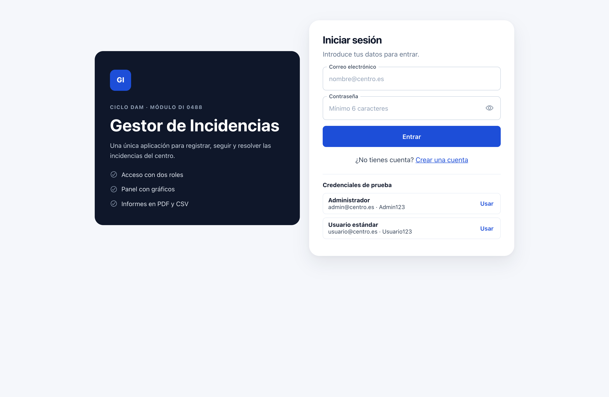
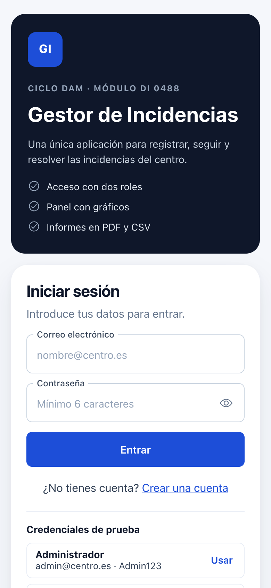
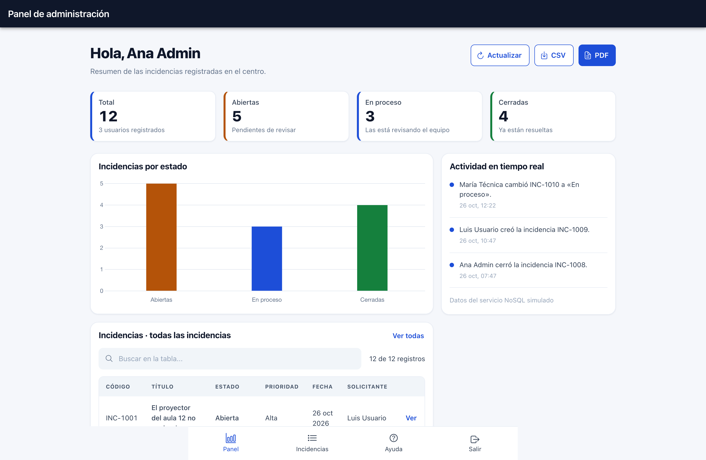
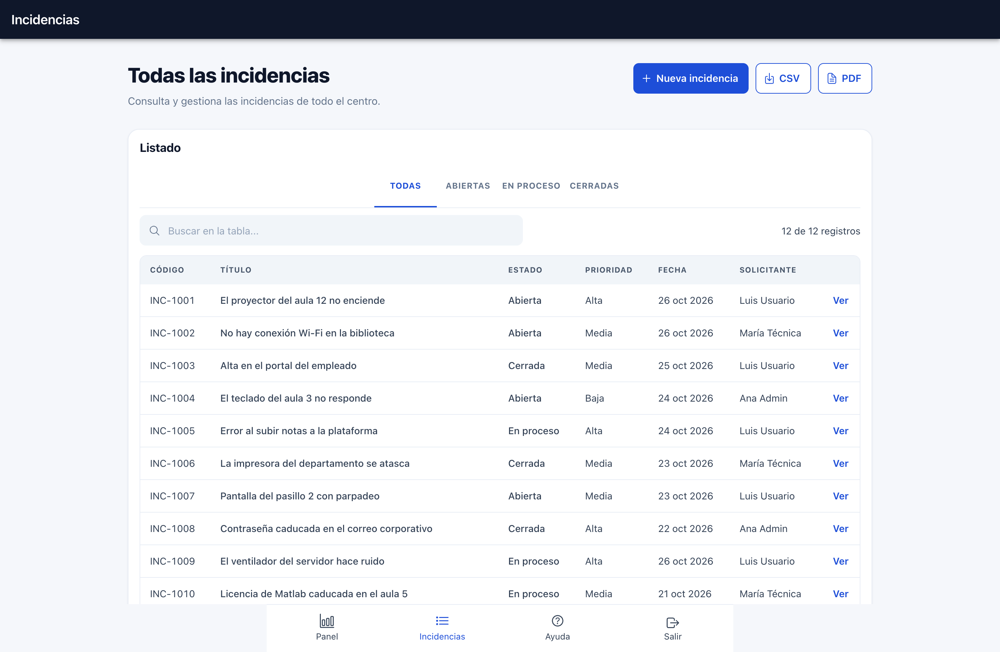
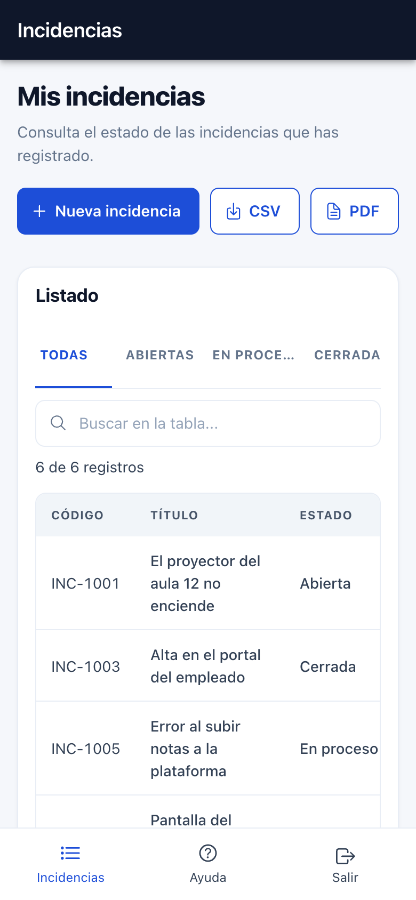
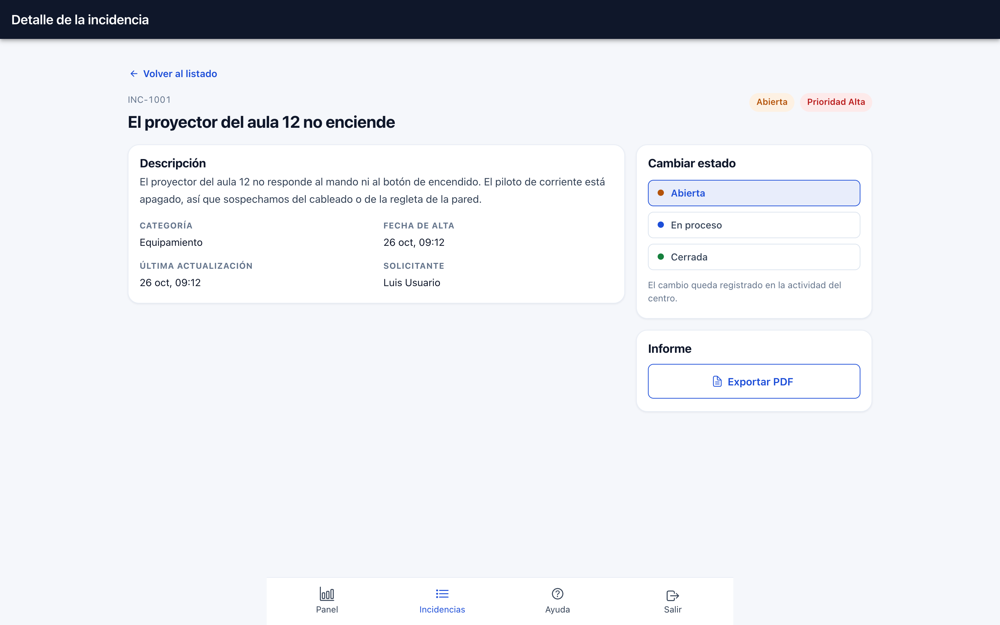

# Gestor de Incidencias

Aplicación web (y app híbrida) para **registrar, seguir y resolver las incidencias técnicas de un
centro educativo**: desde un proyector que no enciende hasta una licencia de software caducada.
Proyecto de entrega del **módulo DI 0488** del Ciclo Formativo de Grado Superior en Desarrollo de
Aplicaciones Multiplataforma (DAM), construido con **Angular 22** e **Ionic 9**.

La interfaz está en español, se adapta a escritorio y móvil y replica la maqueta de la entrega:
cabecera oscura, tarjetas blancas con esquinas redondeadas, panel con gráfico de estados y barra de
navegación inferior.

> **Aviso rápido:** todos los usuarios, incidencias y actividad son **datos ficticios** y viven en
> memoria. No hay backend ni base de datos real. Consulta el
> [aviso sobre los datos](#aviso-sobre-los-datos).

**Repositorio:** <https://github.com/N1C0SM/gestor-incidencias> ·
**Documentación:** <https://n1c0sm.github.io/gestor-incidencias/>

No hay una demo publicada en Internet: la aplicación se ejecuta en local siguiendo los pasos de
[Puesta en marcha](#puesta-en-marcha).

## Capturas

Las imágenes están tomadas de la aplicación en funcionamiento (`docs/capturas/`).

**Acceso** — misma pantalla en escritorio y en móvil:





**Panel de administración** — indicadores, gráfico por estado y actividad reciente:



**Listado de incidencias** — filtros por estado, buscador y contador:





**Detalle de una incidencia** — con el cambio de estado reservado al administrador:



## Índice

- [Capturas](#capturas)
- [Características](#características)
- [Stack técnico](#stack-técnico)
- [Puesta en marcha](#puesta-en-marcha)
- [Scripts disponibles](#scripts-disponibles)
- [Credenciales de prueba](#credenciales-de-prueba)
- [Roles y permisos](#roles-y-permisos)
- [Rutas de la aplicación](#rutas-de-la-aplicación)
- [Estructura del proyecto](#estructura-del-proyecto)
- [Arquitectura de datos simulados](#arquitectura-de-datos-simulados)
- [Calidad del código](#calidad-del-código)
- [Despliegue](#despliegue)
- [Flujo de trabajo con Git](#flujo-de-trabajo-con-git)
- [Autor](#autor)
- [Aviso sobre los datos](#aviso-sobre-los-datos)

## Características

- **Acceso y registro**: inicio de sesión con validación en vivo y cuentas de prueba, y registro de
  nuevas cuentas con comprobación asíncrona de que el correo no esté repetido.
- **Gestión de incidencias**: alta guiada (título, categoría, prioridad y descripción), listado
  filtrable por estado y pantalla de detalle con el historial de fechas y el solicitante.
- **Permisos por rol**: el usuario ve y exporta solo sus incidencias; el administrador ve las de todo
  el centro y puede cambiarlas de estado.
- **Panel de administración**: cuatro tarjetas de resumen que filtran la tabla, gráfico de barras con
  Chart.js y actividad del sistema en tiempo real.
- **Informes**: exportación a **CSV** (compatible con Excel) y a **PDF** maquetado, tanto del listado
  filtrado como de una incidencia concreta.
- **Ayuda integrada**: manual de uso dentro de la propia aplicación, con credenciales de prueba,
  explicación de los estados y tabla de permisos.
- **PWA y app nativa**: compilación de producción instalable con _service worker_ y configuración de
  Capacitor lista para empaquetar la misma base de código en Android e iOS.
- **Accesibilidad**: HTML semántico, jerarquía de encabezados, tablas con `<caption>` y `scope`,
  `aria-live` en los mensajes, enlace «saltar al contenido» y foco visible.

## Stack técnico

| Tecnología              | Versión   | Para qué se usa                                                                  |
| ----------------------- | --------- | -------------------------------------------------------------------------------- |
| Angular                 | 22.2      | Framework de la SPA: componentes standalone, _signals_, rutas con carga perezosa |
| Ionic                   | 9.0       | Componentes de interfaz (modo Material): cabecera, botones, toasts, segmentos    |
| TypeScript              | 6.0       | Lenguaje base, con `strict` y `strictTemplates`                                  |
| RxJS                    | 7.8       | Flujos del feed de actividad y de la validación asíncrona                        |
| Chart.js                | 4.6       | Gráfico de barras de incidencias por estado del panel                            |
| jsPDF + jspdf-autotable | 4.2 / 5.0 | Generación de los informes PDF en el navegador                                   |
| Angular Service Worker  | 22.2      | Soporte PWA: caché e instalación de la compilación de producción                 |
| Capacitor               | 8.5       | Empaquetado de la aplicación como app nativa de Android e iOS                    |
| Sass                    | —         | Tokens de diseño y estilos de los componentes                                    |
| Vitest + jsdom          | 5.0 / 30  | Pruebas unitarias de servicios, guards y validadores                             |
| ESLint + angular-eslint | 10 / 22   | Análisis estático del TypeScript y de las plantillas                             |
| Compodoc                | 2.0       | Documentación generada del código                                                |
| Prettier                | 3.8       | Formato uniforme de ficheros                                                     |

## Puesta en marcha

Requisitos:

- **Node.js 22.22.3 o superior** (también 24.15+ o 26+); el proyecto se ha desarrollado con Node
  24.21 y npm 11.4.
- **npm 8 o superior** (el proyecto fija npm 11.4.1 en `package.json`).

```bash
# 1. Instala las dependencias
npm install

# 2. Arranca el servidor de desarrollo
npm start
```

La aplicación queda disponible en **<http://localhost:4200>**. El servidor recarga la página
automáticamente al guardar cambios.

Para compilar y comprobar tipos y plantillas antes de entregar:

```bash
# Compilación de producción; el resultado queda en www/
npm run build

# Compilación de desarrollo en modo vigilancia (sin optimizar)
npm run watch
```

La carpeta `www/` es un sitio estático, pero el enrutado es de una SPA: al servirla hay que redirigir
las rutas desconocidas a `index.html`.

## Scripts disponibles

Todos los scripts están definidos en `package.json`:

| Script                | Qué hace                                                                    |
| --------------------- | --------------------------------------------------------------------------- |
| `npm start`           | Servidor de desarrollo (`ng serve`) en <http://localhost:4200>              |
| `npm run serve`       | Alias de `npm start`                                                        |
| `npm run build`       | Compilación de producción con optimización, service worker y presupuestos   |
| `npm run watch`       | Compilación de desarrollo en modo vigilancia                                |
| `npm test`            | Pruebas unitarias en modo vigilancia (Vitest + jsdom)                       |
| `npm run test:ci`     | Pruebas unitarias en una sola pasada (configuración `ci` de `angular.json`) |
| `npm run lint`        | ESLint sobre el TypeScript y las plantillas                                 |
| `npm run lint:fix`    | ESLint corrigiendo lo que sea corregible automáticamente                    |
| `npm run format`      | Prettier sobre `src/**`                                                     |
| `npm run docs`        | Genera la documentación de Compodoc en `docs/`                              |
| `npm run docs:serve`  | Genera la documentación y la sirve en el navegador                          |
| `npm run cap:sync`    | Sincroniza la compilación web con los proyectos nativos de Capacitor        |
| `npm run cap:android` | Abre el proyecto de Android en Android Studio                               |
| `npm run cap:ios`     | Abre el proyecto de iOS en Xcode                                            |

## Credenciales de prueba

La aplicación arranca con tres cuentas ya creadas. Para entrar basta con escribir el correo y la
contraseña; las dos cuentas principales también se pueden rellenar con un clic en **Usar**, en la
pantalla de acceso:

| Rol           | Correo              | Contraseña   | Nombre en los datos de ejemplo |
| ------------- | ------------------- | ------------ | ------------------------------ |
| Administrador | `admin@centro.es`   | `Admin123`   | Ana Admin                      |
| Usuario       | `usuario@centro.es` | `Usuario123` | Luis Usuario                   |
| Administrador | `maria@centro.es`   | `Maria123`   | María Técnica                  |

> Las cuentas creadas desde la pantalla de registro también funcionan durante la sesión, pero se
> pierden al recargar porque se guardan en memoria.

## Roles y permisos

| Acción                                 | Usuario             | Administrador |
| -------------------------------------- | ------------------- | ------------- |
| Iniciar y cerrar sesión                | Sí                  | Sí            |
| Crear una incidencia                   | Sí                  | Sí            |
| Ver todas las incidencias del centro   | No, solo las suyas  | Sí            |
| Cambiar el estado de una incidencia    | No                  | Sí            |
| Ver el panel con el gráfico de estados | No                  | Sí            |
| Exportar el listado a CSV o PDF        | Sí, sus incidencias | Sí, todas     |

El panel está protegido por `adminGuard`: si una cuenta de usuario escribe `/app/panel`, la
aplicación la devuelve al listado. En el listado, la columna «Solicitante» solo aparece para el
administrador.

## Rutas de la aplicación

| Ruta                       | Pantalla         | Protección   | Descripción                                        |
| -------------------------- | ---------------- | ------------ | -------------------------------------------------- |
| `/`                        | —                | —            | Redirige a `/app`                                  |
| `/login`                   | `LoginPage`      | `guestGuard` | Acceso con las credenciales de prueba              |
| `/registro`                | `RegistroPage`   | `guestGuard` | Creación de una cuenta nueva                       |
| `/app`                     | `ShellComponent` | `authGuard`  | Cabecera + contenido + barra de navegación         |
| `/app/panel`               | `DashboardPage`  | `adminGuard` | Panel de administración (solo administradores)     |
| `/app/incidencias`         | `ListadoPage`    | sesión       | Listado de incidencias del centro o del usuario    |
| `/app/incidencias/nueva`   | `NuevaPage`      | sesión       | Formulario de alta de una incidencia               |
| `/app/incidencias/:codigo` | `DetallePage`    | sesión       | Detalle, cambio de estado y exportación individual |
| `/app/ayuda`               | `AyudaPage`      | sesión       | Manual de uso de la aplicación                     |

## Estructura del proyecto

```text
gestor-incidencias/
├── src/
│   ├── app/
│   │   ├── core/                     # Lógica independiente de la interfaz
│   │   │   ├── data/seed.ts          # Usuarios, incidencias y actividad iniciales
│   │   │   ├── guards/guards.ts      # authGuard, adminGuard y guestGuard
│   │   │   ├── models/               # Usuario, Sesion, Incidencia, Actividad, Estadisticas…
│   │   │   ├── services/             # SqlService, NosqlService, AuthService, ExportService…
│   │   │   ├── utils/                # Etiquetas, fechas y almacenamiento local
│   │   │   └── validators/           # Contraseña segura, correo disponible…
│   │   ├── pages/
│   │   │   ├── auth/                 # login y registro
│   │   │   ├── dashboard/            # panel de administración con Chart.js
│   │   │   ├── incidencias/          # listado, nueva y detalle
│   │   │   ├── ayuda/                # manual de uso
│   │   │   └── shell/                # marco de la zona autenticada
│   │   ├── shared/components/        # header, tabbar, brand-panel, stat-card, data-table, campo
│   │   ├── app.config.ts             # Providers: Ionic (md), router y service worker
│   │   ├── app.routes.ts             # Rutas con carga perezosa
│   │   └── app.ts                    # Componente raíz
│   ├── theme/variables.scss          # Tema de Ionic (colores y tipografía)
│   ├── styles.scss                   # Tokens de diseño y clases globales «gi-*»
│   ├── index.html                    # Metadatos, manifest e idioma español
│   ├── main.ts                       # Arranque de Angular
│   └── test-setup.ts                 # Polyfills de jsdom para las pruebas
├── public/                           # manifest.webmanifest, favicon e iconos de la PWA
├── angular.json                      # Configuración de build, serve y test
├── capacitor.config.ts               # appId, nombre y webDir de la app híbrida
├── eslint.config.mjs                 # ESLint (flat config) con reglas de Angular y accesibilidad
├── ionic.config.json                 # Proyecto Ionic standalone con integración Capacitor
├── ngsw-config.json                  # Caché de la PWA
├── tsconfig.doc.json                 # Fichero de TypeScript para Compodoc
├── tsconfig.json                     # Opciones estrictas y alias @core, @shared, @pages
└── package.json
```

`www/` (salida de la compilación para Capacitor) y `.angular/` están excluidas del repositorio.
En cambio, `docs/` **sí se versiona**: contiene la documentación generada con Compodoc y los
informes de Lighthouse, que forman parte de la entrega.

## Arquitectura de datos simulados

No hay backend. Toda la persistencia es una **simulación didáctica en memoria** que se inicializa
desde `src/app/core/data/seed.ts` (3 usuarios, 12 incidencias y 3 eventos de actividad):

```text
Páginas (standalone, OnPush)
   │ inject()
   ▼
AuthService ──► SqlService ──► seed.ts        (usuarios e incidencias)
   │               │
   │               └──► NosqlService           (feed de actividad, RxJS)
   │
   └──► localStorage («gi.sesion»)

Páginas ──► ExportService ──► jsPDF / CSV     (informes en el navegador)
```

- **`SqlService`** simula una base de datos relacional con dos tablas, `usuarios` e `incidencias`.
  Todas sus operaciones devuelven `Promise` y esperan un retardo de 160 ms para que la interfaz tenga
  que gestionar estados de carga, como ocurriría con un servidor real. Devuelve copias defensivas de
  los registros y ordena las incidencias por código. Las altas nuevas reciben códigos correlativos a
  partir de `INC-1013`.
- **`NosqlService`** representa una colección de documentos de solo lectura: el feed de actividad.
  Se implementa con un `BehaviorSubject` de RxJS (`actividad$`), de modo que cada cambio de estado o
  alta aparece al instante en el panel.
- **`AuthService`** guarda la sesión en un `signal` (`usuario`, `autenticado`, `esAdmin`, `nombre`,
  `iniciales`, `rutaInicio`) y la refleja en `localStorage` para sobrevivir a una recarga. Las
  credenciales se validan contra `SqlService`.
- **`ExportService`** genera el CSV (UTF-8 con BOM y separador `;`) y los PDF con jsPDF y autoTable,
  directamente en el navegador.
- **`NotificacionService`** centraliza los avisos emergentes de Ionic.

Consecuencia importante: **los cambios no se persisten**. Al recargar la página vuelven los datos de
ejemplo; lo único que se conserva es la sesión iniciada, que se borra al cerrar sesión.

## Calidad del código

- **Pruebas unitarias** con Vitest y jsdom: **11 pruebas en 5 ficheros**, que cubren `SqlService`
  (acceso, correo disponible, alta y estadísticas), `AuthService` (sesión en el signal y en el
  almacenamiento), `ExportService` (CSV y lista vacía), los guards de ruta y los validadores
  (`emailExistsValidator` y `contrasenasCoinciden`). Se ejecutan con:

  ```bash
  npm run test:ci
  ```

- **ESLint 10** con angular-eslint: reglas de TypeScript y de accesibilidad de plantillas,
  prohibición de `any` explícito y de `console.log` (`no-console`). Se ejecuta con:

  ```bash
  npm run lint
  ```

- **Prettier 3** para el formato (`.prettierrc`, 100 columnas y comillas simples) y **TypeScript
  estricto** (`strict`, `strictTemplates`, `noImplicitReturns`…), con presupuestos de tamaño en
  `angular.json` para avisar si el _bundle_ crece.
- **Accesibilidad**: estructura semántica, encabezados ordenados, tablas con `<caption>` y
  `scope`, textos alternativos y `aria-live` para los mensajes, foco visible y enlace «saltar al
  contenido». El objetivo es cumplir las pautas WCAG 2.1 AA.
- **PWA y rendimiento**: la compilación de producción registra un _service worker_ con
  `ngsw-config.json`, carga perezosa de las pantallas y fuentes del sistema (sin peticiones
  externas), por lo que la aplicación se puede auditar con Lighthouse.

### Resultados de Lighthouse

Auditorías sobre la compilación de producción (`www/`), guardadas en
[`docs/lighthouse/`](docs/lighthouse):

| Categoría | Escritorio | Móvil |
| --- | --- | --- |
| Accesibilidad | **100** | **100** |
| Buenas prácticas | **100** | **100** |
| SEO | **100** | **100** |
| Rendimiento | 89 | 59 |

Informes completos: [escritorio](docs/lighthouse/escritorio.report.html) ·
[móvil](docs/lighthouse/movil.report.html). El rendimiento móvil se mide con CPU y red
emuladas (4G lento); el resto de categorías no depende de la red.
- **Documentación** con Compodoc:

  ```bash
  npm run docs        # genera la documentación en docs/
  npm run docs:serve  # la genera y la abre en el navegador
  ```

## Despliegue

### Web (Vercel, Netlify o cualquier servidor estático)

1. Compila en producción con `npm run build`; el resultado queda en `www/`.
2. Publica `www/` como sitio estático.
3. Configura una reescritura de SPA: todas las rutas que no sean un fichero deben servir
   `index.html`. En Vercel basta con indicar `npm run build` como comando, `www` como directorio de
   salida y una reescritura de `/(.*)` a `/index.html`; en Netlify, un `_redirects` con
   `/* /index.html 200`.
4. La PWA necesita **HTTPS** para que el _service worker_ se registre (en `localhost` también
   funciona). En desarrollo el _service worker_ está desactivado: solo se activa en la compilación de
   producción.

### App nativa con Capacitor

El proyecto incluye las dependencias de Capacitor 8 y `capacitor.config.ts` ya configurado
(`appId` `es.nebrija.gestorincidencias`, `appName` «Gestor de Incidencias» y `webDir` `www`):

```bash
npm run build          # genera www/ que consumirá Capacitor
npx cap add android    # solo la primera vez: crea el proyecto nativo
npx cap add ios        # solo la primera vez (requiere macOS y Xcode)
npm run cap:sync       # copia www/ y sincroniza los plugins
npm run cap:android    # abre Android Studio
npm run cap:ios        # abre Xcode
```

Las carpetas nativas (`android/`, `ios/`) se generan con `cap add` y no forman parte del código
fuente de la aplicación web. Para iOS hace falta un Mac con Xcode; para Android, Android Studio con
un SDK instalado. `ionic.config.json` declara el proyecto como _standalone_ con integración de
Capacitor.

## Flujo de trabajo con Git

El proyecto se organiza con una **adaptación de Git Flow**, el modelo de ramas habitual para el
trabajo en equipo:

- `main`: entregas estables y etiquetadas (`v1.0.0`).
- `develop`: rama de integración de las funcionalidades terminadas.
- `feature/*`: una rama por pantalla o bloque de trabajo (`feature/panel-dashboard`,
  `feature/alta-incidencias`, `feature/pantalla-ayuda`…).
- `release/*`: preparación de una entrega (solo correcciones y documentación).
- `hotfix/*`: correcciones urgentes que nacen de `main` y vuelven a `main` y a `develop`.

Convenciones:

- **Commits** con _Conventional Commits_ y ámbito entre paréntesis: `feat(incidencias): añade el
alta con validación en vivo`, `fix(auth): corrige el guard de administrador`,
  `docs(readme): documenta los scripts`, `test(servicios): cubre el alta de incidencias`.
- **Pull requests** hacia `develop` con revisión de al menos otra persona y sin _warnings_ de ESLint
  ni pruebas en rojo.
- **Etiquetas** de versión (`v1.0.0`) en cada entrega.

## Autor

**Nicolás San Marcos** — proyecto académico del **módulo DI 0488** (Ciclo Formativo de Grado
Superior en Desarrollo de Aplicaciones Multiplataforma).

## Aviso sobre los datos

> **Todos los datos de la aplicación son ficticios.** Los usuarios, las incidencias, las fechas y la
> actividad están inventados para el ejercicio y viven únicamente en memoria.

- El estado inicial se carga en cada arranque desde `src/app/core/data/seed.ts`; la «base de datos»
  simulada de `src/app/core/services/sql.service.ts` no existe fuera del navegador.
- No se envía ninguna información a un servidor ni se guarda en disco. Lo único que persiste es la
  sesión en `localStorage` (clave `gi.sesion`), y se borra al cerrar sesión.
- Al recargar se pierden las cuentas registradas durante la sesión y los cambios de estado: vuelven
  las 3 cuentas y las 12 incidencias de ejemplo.
- El proyecto **no debe usarse con datos reales** de personas ni del centro en su estado actual: es
  una simulación didáctica.

Las librerías de terceros utilizadas (Angular, Ionic, Chart.js, jsPDF, etc.) se distribuyen con
licencias de código abierto (MIT en la mayoría de los casos); consulta el fichero `package.json`
para ver el detalle de dependencias.
